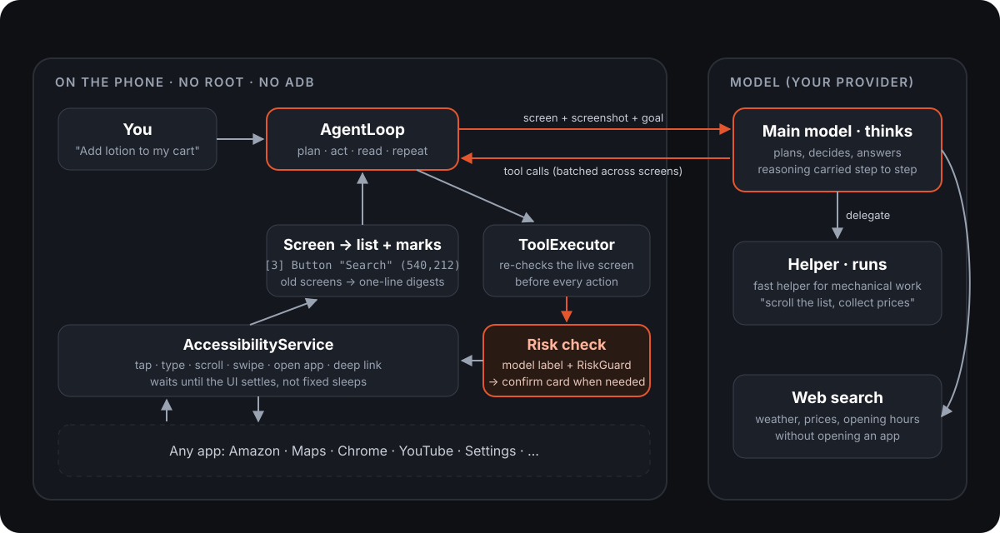

# OpenPhoneUse architecture

This note explains how a request becomes taps on the phone. Paths below are relative to
`app/src/main/java/com/phoneuse/`.



## One run, step by step

1. **Entry.** `app/AgentRunner` starts a run for a chat message, the overlay, the side-button assistant, or a
   routine.
   - It resolves the model provider (`resolveBackend`) into a `ModelBackend` (`app/ModelBackend`); see
     [Model providers](#model-providers).
   - It picks the model options: model, reasoning effort, fast tier.
   - It builds the prompt (`agent/AgentPrompt`).
2. **Loop.** `agent/AgentLoop` repeats the following until `finish`, a text-only answer, or the step limit:
   - Stream a model turn.
   - Run its tool calls.
   - Append the results.

   Only the newest screen tree and the newest screenshot stay in full. Older trees are cut to a single line and
   older screenshots to a short placeholder, which keeps the input small and the prompt cache warm.
3. **Tools.** Each family of tools is a `ToolModule` (`agent/ToolModule`) that declares its specs and runs its
   calls. `agent/ToolRegistry` lists them in tool-list order, and `agent/ToolExecutor` offers their specs and
   routes each call:
   - the screen tools (tap, scroll, batch, ...), which live in `ToolExecutor` because they share its screen state;
   - `FileModule`: files;
   - `UserModule`: ask_user, hand_to_user;
   - `MemoryModule`: memory and conversations;
   - `PhoneModule`: location, directions, reminders, calendar, contacts, alarms, photos;
   - `RoutineModule`: make_routine;
   - `ReplyModule`: show_card, finish;
   - `MessagingModule`: notifications, SMS;
   - `PlanModule`: update_plan, the agent's own checklist for long tasks;
   - `ConnectorModule`: the connector and MCP tools.

   A new module is one file plus one line in `ToolRegistry`; see `DeviceInfoModule` and
   [CONTRIBUTING.md](../CONTRIBUTING.md#add-a-tool-module-in-5-steps).
4. **Device.** `service/AccessibilityDeviceController` does the work on the phone:
   - It carries out gestures with `dispatchGesture`. Swipes are kept out of the system gesture strips by
     `service/EdgeGuard`.
   - It runs global actions, text entry and scrolling.
   - It reads the screen through `service/AccessibilityTreeReader`.

## Screen representation

Every screen read goes to the model in two forms (vision first): a text list and a marked screenshot.

`screen/TreeCompressor` keeps visible elements that have text or can be acted on. Children's text is folded into
their actionable parent. Each element becomes one line, for example:

```
app: com.coupang.mobile | screen 1080x2400 | list continues below (more-below): scroll to see the rest
[1] EditText "검색어를 입력하세요" clickable editable (540,180)
[2] RecyclerView "" scrollable more-below (540,1300)
[3] View "무선 이어폰 ... 29,900원" clickable (540,640)
```

- `more-above` and `more-below` come from the scroll actions the node offers. They tell the model that the list
  has content it has not seen.
- `screen/ScreenBusy` detects loading indicators, so the agent does not act on a half-drawn screen.

**Marked screenshot (Set-of-Mark).** `ToolExecutor` attaches a screenshot to every screen it returns, and
`AgentLoop` adds it to the input (`addImage`). Each element you can act on is outlined and tagged with its list
number. `agent/MarkLayout` places the tags (pure geometry, tested on the JVM; at most 120 tags per image) and
`service/MarkPainter` draws them, so the model reads layouts, icons, charts and games from the picture and still acts
by number. There is no screenshot when the setting that sends text only is on, or on a protected screen where the
capture is blocked; the text list is always sent. `screenshot` remains a tool for a fresh look.

## Speed

- **Settling (`service/IdleWaiter`).** After an action, a wait ends at the first of these:
  - no UI event within 600 ms (the action had no visible effect);
  - 150 ms of quiet;
  - two identical samples taken 120 ms apart;
  - a 1.5 s cap.
- **Batches.** `batch` runs several steps in one model call.
  - A step can name its element by `index`, which refers to the screen the model saw.
  - A step can instead name it by `target`, a visible label that is waited for for up to 3 s on a new screen.
  - Either way, one model call can go through several screens.
- **Live re-check.** Before every act, the live screen is read again and the target element is found there.
  - If the element is gone, the executor returns `STOPPED` with the fresh screen.
  - It never taps something that moved.
- **Speculation (`agent/ScreenWatch`, `AgentLoop`).** The next model call starts as soon as the screen looks
  settled, before the full settle window has passed. While the model thinks, the loop polls the live screen
  (every 120 ms) and compares it with the one the model was sent; if it changes within the remaining window, the
  call is cancelled and sent again with the new screen (at most twice per step, after which the step waits as
  before). The model never acts on a screen older than a full settle would have given it. The benchmark runner's
  `--spec off` switches this off for comparison.

## Model providers

`app/ModelProviders` holds what each provider brings (key name, chosen model, defaults, model list) and
`app/ModelBackend` builds the `ModelClient` for a run. All of them stream through the same `ModelClient` interface.

| Provider | Sign-in | Client | Default model | Helper model |
|---|---|---|---|---|
| ChatGPT plan | `auth/PlanAuth`: OpenAI's "Sign in with ChatGPT" plan usage on `api.openai.com`. | `OpenAiResponsesClient` | `gpt-6.1-terra`, fast mode on | `gpt-6-luna` |
| OpenAI API key | `auth/ApiKeyAuth` | `OpenAiResponsesClient` | same | same |
| Claude | API key | `model/ClaudeClient`, on Anthropic's Java SDK | `claude-opus-5-5` | `claude-haiku-5-5` |
| Grok, Gemini | API key | `model/ChatCompletionsClient` (their Chat Completions endpoints) | `grok-4`, `gemini-flash-latest` until you pick one | none |

- Fast mode is OpenAI's priority tier (`service_tier`), so only the two OpenAI modes use it. The plan route can refuse it (`subscription_sharing_unsupported_capability` naming the field); the client then retries without it and does not send it to that model again this session.
- Hosted web search is offered for OpenAI and Claude, not for Grok or Gemini.
- Keys are stored in `SecretBox`. Each provider keeps its own chosen model.

## Terra + Luna helper

`agent/Helper` runs the `delegate` tool. It works like this:

- The main model gives a concrete task, for example "scroll the results to the end and collect name and price".
- A lighter model (the provider's helper model, low effort: GPT-6 Luna or Claude Haiku) does the task on its own
  small loop. A provider without a light model (Grok, Gemini) has no helper.
- The helper may use only in-app screen tools: no `open_app`, no data tools, no `finish`.
- Its calls go through the same `ToolExecutor`, so every risk check, confirmation and taint rule still applies.
- It stops in any of these cases:
  - it calls `report`;
  - three steps in a row fail;
  - the user cancels a confirmation;
  - it reaches its step limit;
  - its model call fails, in which case `delegate` is no longer offered for the rest of the run.

The main model gets the report and the final screen, and makes every decision itself.

## Context across steps

OpenAI requests are not stored on the server (`store: false`). Each model call is therefore stateless unless the app sends the context back itself. The app sends back three things:

- **Reasoning.** The OpenAI client asks for `reasoning.encrypted_content` and keeps each turn's reasoning items without their ids. `AgentLoop` puts them back in the input before that turn's calls, so the next step continues the model's own plan. `ClaudeClient` does the same with the signed thinking blocks of a turn, sent back unchanged. The Chat Completions clients (Grok, Gemini) have no reasoning to carry.
  - A backend that rejects this is remembered, and the session runs without it.
- **Journal.** `agent/ScreenJournal` keeps older screens as one-line digests, for example `[earlier screen: <app> · label | label …]`, instead of dropping them.
- **Revisits.** A screen that matches an earlier one is marked `Seen before: … after step 2 (탭: 자산) (3 visits)`. Screens are compared with digits ignored, so live prices do not count as a change.

These are facts, not rules. The model decides when it is going in circles and changes approach or finishes. The only fixed stop is the run's step limit. The helper gets the same reasoning and journal and judges its own progress.

## Depth per request

There are no keyword rules for how much work a request gets. The prompt asks the model to decide first what result
the request wants and how deep that needs, and gives it examples:

- a simple lookup (weather): one check, a short answer, no app opened;
- a simple action (Wi-Fi off): only that action, then confirm the result;
- a request that involves choosing (add to cart, recommend, book): compare several candidates, using the helper for
  long lists;
- an exhaustive request (cheapest, all): look to the end of the list.

The harness supplies facts the model can judge from: `more-below` on lists, the screen journal, and the helper's
report. Scenario tests in `AgentLoopTest` cover two cases:

- a weather question never touches the phone;
- a Coupang cart task compares through the helper and adds to the cart without a pay confirmation, while "바로구매"
  is still confirmed.

`RiskGuard` ignores past-purchase wording on product cards ("1만명 이상 구매", "구매후기", "주문내역"). Browsing a
shop therefore does not raise money confirmations, but buying buttons still do.

## Answers

- The reply is Markdown. `ui/chat/Markdown` renders a small subset: headings, lists, pipe tables, code, rules,
  `>` key lines (shown as a highlighted box), bold, italic and code spans.
- The prompt asks for the result first with key values in bold, tables for comparisons of three or more items, and
  no filler: no process narration, no generic advice, no repeated caveats.
- `model/WebSearch.stripMarks` removes the hosted search's inline citation marks from the streamed text and the
  final reply. Sources are shown under the answer instead.

## Notifications

`notify/Notifier` posts every notification: one set of channels (results, needs your OK, running task, routines,
daily summary, nudges, reminders), the app's mark as the status-bar icon and its accent colour. Each one
opens a place (`notify/Taps`), through a signed intent (`LaunchToken`):

- A result opens its conversation at the start of the answer. It shows the conversation's title and the answer
  without Markdown marks (`notify/NotifyText`), and offers Open, Follow up (an inline reply sent to the same
  conversation) and Copy.
- A card waiting in the chat while the app is not in front becomes a "needs your OK" notification. Approve and
  Deny answer it through the chat card's own path. Money, security and delete cards get "Review" instead of Approve,
  which opens the card in the app (`notify/NeedsOk`).
- A run shows an ongoing notification with its latest progress line and Stop, throttled by `notify/UpdateThrottle`.
- Inside the quiet hours, notifications that would make a sound go to a silent channel (`QuietChannel`).

## Safety

- `risk/RiskGuard` classifies what an action does from keywords on the element and its screen: MONEY, SECURITY,
  DELETE, SEND or CHANGE. A match is *strong* (high-precision words such as pay, transfer, delete account) or weak.
- **Inline judgment.** There is no separate risk-judge model call. `tap`, `long_press`, `type_text` and `swipe` carry
  `risk`, `effect` and `delete_scope` arguments that the acting model fills in the same call, from the screen and
  screenshot (`agent/RiskJudge`: `PROPS`, `PROMPT`, `fromArgs`). Leaving `risk` out declares the step harmless.
  Settings "AI safety check" switches it off, which leaves the keywords alone.
- **Combine.** `RiskCombine` merges the keyword match with the declaration. A strong keyword always stands and the
  declaration can only raise it. A weak keyword is the declaration's call: it can clear it or replace it with
  another category. With no keyword, the declaration's category counts, except CHANGE, which does not ask on its own.
- `agent/PointRisk` checks coordinate taps and swipes against the live element.
- The confirm gate (`ConfirmGate`, `agent/ConfirmPolicyGate`) shows a card for every risky action.
  - Money and security actions are always confirmed.
  - A delete is confirmed unless the model declares `delete_scope=requested_one` (exactly the single, recoverable
    item the user's own message names) and the request and screen carry no bulk or permanent wording
    (`RiskGuard.irreversible`). Delete-all, empty trash, uninstall and reset always ask.
  - Send and change actions can be relaxed in settings. A direct send whose recipient and content the user named
    in their own message does not need confirming.
- **Taint.** A run becomes *tainted* once it has seen text from outside the user (web, notifications, other
  apps, attachments). In a tainted run:
  - sends are always confirmed;
  - saves to calendars and albums go through card buttons;
  - new memories are stored only as guesses.
- **Secrets.** `security/SecretBox` encrypts tokens with an Android Keystore key.

## Home-screen widgets

`widget/` holds six Jetpack Glance widgets: an ask bar, the live task, a Today brief, quick-action tiles,
routines, and a "remember this" memory capture.

- **Same path as typing.** A widget never runs a task itself. A tap opens the chat with a prompt signed by
  `LaunchToken` (`WidgetLinks`). What the user typed in the quick-ask sheet starts like composer text; chips and
  tiles start like a card button. All the usual confirmations therefore still apply.
- **In-place buttons.** Stop, refresh brief and run routine are Glance callbacks. Each one carries a signed action
  and checks it before it does anything. Run routine is the routines screen's "지금 실행".
- **Live state.** `WidgetSync` follows the runner, throttled to one redraw a second, and also follows the
  routine, tile and memory stores.
- **Brief.** `BriefWorker` (WorkManager) writes the brief with one light model call that has no tools, over the
  phone's own data, which is passed in as quoted data. It falls back to local text and caches the result. It only
  reads.

## Tests

`app/src/test` holds more than 1,100 JVM unit tests. They use the following fakes:

- `FakeDeviceController`, a scripted list of screens;
- `FakeUserGate`;
- a scripted model client;
- `InMemoryChatRepository` and `InMemoryMemoryStore`.

With these, the agent loop, executor, risk gates, routines and parsers run without a device.
